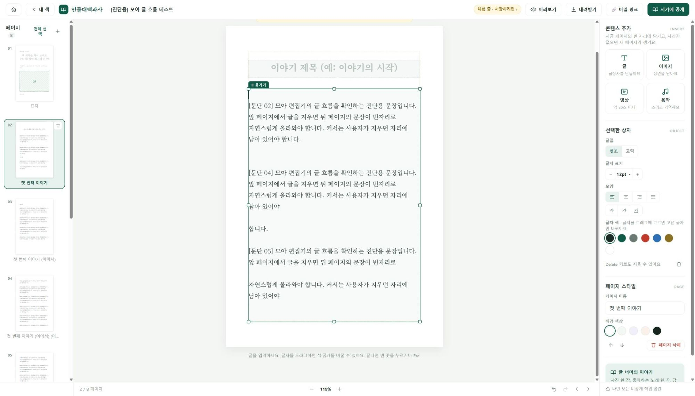

# 모아 개발자 수정 요청서

본문 편집 안정화와 원고 보존을 위한 1차 품질 진단

작성일 2026년 10월 16일  |  관찰일 2026년 10월 15일  |  버전 1.0

수신 모아 개발 담당자  |  대상 인물대백과사 멀티미디어 전자책 편집기

**우선 요청은 긴 글의 편집 신뢰성 회복입니다.** 중간 문단 삭제 후 커서 이동, 자동으로 이어진 페이지 경계의 삭제 실패, 문단 구조 변형, 붙여넣기 직후 실행 취소 실패를 재현했습니다. 아래 네 건을 먼저 수정하고, 7쪽 점검표로 회귀 검증 결과를 회신해 주십시오.

## 재현된 결함과 요청 우선순위

| ID | 수정할 문제 | 우선순위 | 근거 |
| --- | --- | --- | --- |
| F01 | 중간 삭제 후 커서가 글상자 처음으로 이동 | P1 | 직접 재현 |
| F02 | 자동 연결 페이지 경계의 Backspace와 Delete 미처리 | P1 | 직접 재현 |
| F03 | 페이지를 오간 문장이 별도 문단으로 분절 | P1 | 직접 재현 |
| F04 | 긴 글 붙여넣기 직후 Ctrl+Z 한 번으로 원상복구 실패 | P1 | 직접 재현 |

P1은 핵심 글쓰기 작업을 방해하므로 우선 수정할 항목입니다. 뒤의 R01~R06은 코드 검토에서 나온 추가 검증 항목이며, 재현된 결함 수에 포함하지 않습니다. 심각도는 제품 사용 영향 기준입니다.

## 검사 범위

- 공개 체험 편집기에서 새 진단용 원고만 편집했습니다. 기존 사용자 책의 수정·삭제·발행은 하지 않았습니다.
- 브라우저에 배포된 inline JavaScript를 읽었습니다. 저장소 원본, 서버 코드, 데이터베이스 정책은 검토 범위에 포함되지 않았습니다.
- 로그인 상태의 저장·발행·미디어 만료와 실제 한글 IME 조합은 아직 실행 검증하지 않았습니다. 오늘 배포본에 수정이 반영되었는지는 별도 재검증이 필요합니다.

대상 https://archive4everyone.com/studio/?blank=1
회사 홈페이지 https://archive4everyone.com/

---

# 1 공통 재현 준비와 커서 유지

## 공통 준비 S01

1. Windows 브라우저에서 https://archive4everyone.com/studio/?blank=1 을 엽니다. 기존 책 대신 새 체험 화면을 사용합니다.
2. 2쪽 「첫 번째 이야기」를 선택하고, 제목 아래 본문 글상자를 클릭합니다.
3. 첨부된 「모아_재현용_16문단.txt」 전체를 복사해 일반 텍스트로 붙여 넣습니다. 자동 페이지 나눔이 끝날 때까지 기다립니다.
4. 테스트 당시 본문은 4쪽으로 나뉘고 책 전체는 8쪽이 되었습니다. 재검증 시 쪽수 자체보다 글이 3쪽 이상 자동으로 이어졌는지를 확인합니다.
5. 브라우저 이름·버전, OS, 브라우저 확대율, 편집기 확대율, 배포 버전을 기록합니다. 관찰 환경은 Windows의 Codex 내장 브라우저였으며 정확한 브라우저 버전과 고정 화면 크기는 기록되지 않았습니다.

## F01 중간 삭제 후 커서가 처음으로 이동

**상태 직접 재현  |  우선순위 P1  |  영향 연속 삭제와 입력 위치 신뢰성 저하**

1. S01을 완료하고 첫 본문 페이지로 돌아갑니다.
2. 첫 문단 [문단 01]을 선택해 Backspace로 삭제합니다. 이어서 같은 페이지의 [문단 03] 전체를 선택해 Backspace로 삭제합니다. 제목이나 글상자 자체가 아닌 문단 텍스트를 삭제합니다.
3. 뒷페이지의 글이 당겨지고 다시 나뉜 뒤 커서 위치를 확인합니다. 커서를 옮기지 않고 Backspace를 한 번 더 누릅니다.

**기대 동작** 삭제한 문단의 논리적 위치에 커서가 남아야 합니다. 이어지는 Backspace는 그 위치 바로 앞의 문자 또는 문단 경계를 처리해야 합니다.

**실제 결과** [문단 03] 삭제 후 선택 위치가 활성 글상자 `.tx`의 시작점인 offset 0으로 이동했습니다. 이어 누른 Backspace는 텍스트를 바꾸지 못했습니다. 모든 위치에서 Backspace가 고장난 것은 아닙니다.

**코드상 원인** `pullBack()`은 커서를 복원한 뒤 `flowOverflow()`를 호출합니다. 이 함수는 `.tx.innerHTML`을 교체하며, 커서가 기존 페이지에 남는 분기에서 위치를 다시 복원하지 않습니다. [S2: 428, 435, 453~456]

**수정 요청** 재배치 전 선택 시작·끝과 방향을 문서의 논리 위치로 저장하고, 전체 재배치가 끝난 후 복원하십시오. 입력 중 DOM 교체를 줄이고, 같은 페이지에 남는 경우도 복원 대상에 포함하십시오.

**완료 기준** 첫 페이지와 중간 페이지에서 문단 삭제를 3회 연속 수행해도 커서가 지정 위치에 남고, 이어지는 입력·Backspace·Delete가 그 위치에 적용되어야 합니다.

---

# 2 페이지 경계 삭제와 문단 보존

## F02 자동 연결 페이지 경계에서 삭제가 끊김

**상태 직접 재현  |  우선순위 P1**

1. S01을 새로 수행합니다. 앞 본문 페이지의 글상자 맨 끝으로 커서를 옮긴 뒤 Delete를 한 번 누릅니다.
2. 자동으로 이어진 다음 페이지의 글상자 맨 처음으로 이동해 Backspace를 한 번 누릅니다.
3. 대조 검사로 다음 페이지에서 커서를 한 글자 뒤로 옮긴 후 Backspace를 누릅니다.

**기대 동작** 자동 페이지 나눔은 편집 가능한 본문의 연속성을 끊지 않아야 합니다. Delete와 Backspace가 논리적으로 다음·이전 문자 또는 문단 경계를 처리하고, 필요한 재배치를 수행해야 합니다. 사용자가 넣은 강제 페이지 나눔과 독립 글상자는 별도 규칙으로 보호해야 합니다.

**실제 결과** 두 경계 위치에서는 글이 바뀌지 않았습니다. 한 글자 뒤에서 누른 일반 Backspace는 정상 삭제되었습니다.

**원인과 수정 요청** `mergeLineUp()`은 동일 글상자 내부 블록만 합칩니다. 자동 연결된 본문에 대해 페이지를 넘는 삭제와 선택 범위 처리를 구현하십시오. 무조건 앞뒤 페이지를 합치지 말고 연결된 원고인지 확인해야 합니다. [S2: 125~128, 467~489, 603~608]

**완료 기준** 앞쪽 끝 Delete와 뒤쪽 시작 Backspace가 모두 작동하며, 사진 설명·제목·독립 글상자의 내용이 함께 삭제되지 않아야 합니다.

## F03 자동 재배치가 원래 문단 구조를 바꿈

**상태 직접 재현  |  우선순위 P1**

1. S01 후 F01의 앞쪽 문단 삭제를 수행해 뒷페이지 글이 앞으로 당겨지게 합니다.
2. 원고의 「커서는 사용자가 지우던 자리에 남아 있어야 합니다.」 문장이 페이지 경계를 오간 뒤 어떻게 표시되는지 확인합니다.

**실제 결과** 「남아 있어야」와 「합니다.」가 서로 다른 블록으로 나뉘어 불필요한 줄바꿈이 생겼습니다. 확인된 변형은 `
남아 있어야 
 
합니다.
`입니다. 이 검사만으로 글자 자체의 유실까지 확인한 것은 아닙니다.

**원인과 수정 요청** DOM 조각을 잘라 HTML 문자열로 다시 연결하는 과정에서 원래 한 문단의 두 조각을 별도 문단으로 보존합니다. 문단 ID와 의미 구조를 유지하고, 자동 분할 조각과 사용자가 넣은 줄바꿈을 구분하십시오. [S2: 427~431, 454]

**완료 기준** 자동 분할과 되당김을 3회 반복해도 사용자가 넣지 않은 문단·줄바꿈·공백이 생기지 않아야 합니다. 의도한 삭제를 제외한 문장 순서와 문단 경계가 원문과 같아야 합니다.

---

# 3 실행 취소와 수정 설계

## F04 긴 글 붙여넣기를 한 번에 되돌리지 못함

**상태 직접 재현  |  우선순위 P1**

1. 완전히 새 체험 화면에서 S01의 16문단 붙여넣기를 수행합니다.
2. 자동 분할이 끝난 직후 활성 글상자에서 Ctrl+Z를 한 번 누릅니다.
3. 본문 글과 자동 생성된 페이지가 붙여넣기 전 상태로 돌아왔는지 확인합니다.

**기대 동작** 한 번의 붙여넣기와 그 결과로 생긴 자동 페이지 나눔이 하나의 사용자 작업으로 취소되어야 합니다. 다시 하기는 같은 원고·문단·페이지 구성을 복원해야 합니다.

**실제 결과** Ctrl+Z 한 번으로 이전 상태가 복원되지 않았고, 16문단과 책 전체 8쪽이 남았습니다. 여러 번 누른 결과나 실행 취소의 모든 기능을 검사한 것은 아닙니다.

**코드상 원인 후보** 편집 중 Ctrl+Z는 브라우저 기본 이력에 맡기고, 툴바 되돌리기는 앱 자체 이력을 사용합니다. 자동 분할은 별도 `snap()`을 호출하며 편집 DOM도 교체합니다. 이력의 분리가 관찰 결과와 부합하지만, 수정 전 이벤트 순서를 확인하십시오. [S2: 48~51, 353, 426, 595, 603~606]

**수정 요청** 입력·삭제·붙여넣기·페이지 재배치에 공통 실행 취소 단위를 적용하십시오. 키보드와 툴바가 동일한 이력을 사용하도록 정리하고, 붙여넣기 1회는 자동 분할 전체와 함께 하나의 작업으로 묶으십시오.

**완료 기준** 붙여넣기 후 Undo 1회로 원문·페이지·커서가 이전 상태로 돌아오고, Redo 1회로 복구되어야 합니다. 키보드와 툴바에서 같은 결과가 나와야 합니다.

## 권장 구현 순서

1. 현재 코드에서 커서 보존, 자동 연결 페이지의 양방향 삭제, 문단 보존, 실행 취소를 하나의 안정화 작업으로 처리합니다. 함수별 단독 수정 후 끝내지 말고 네 시나리오를 함께 재검증합니다.
2. 중기적으로 본문 원고의 의미 구조와 화면의 페이지 배치를 분리합니다. 본문은 하나의 연결된 문서로 저장하고, 페이지 분할은 표시 결과로 계산하는 방식을 검토합니다.
3. 표지 제목·사진 설명 같은 독립 글상자와 이어지는 본문을 명확히 구분합니다. 원고 ID와 연결된 글상자 ID로 관계를 표현하고, 자동 나눔과 강제 나눔을 별도로 관리합니다.

특정 편집 라이브러리 도입이나 전면 재작성을 요구하는 문서는 아닙니다. 현재 저장 형식과 기존 책의 호환성을 보존하는 최소 변경안과 구조 개선안을 개발자가 비교해 제안해 주십시오.

---

# 4 추가 검증 항목 입력과 원고 흐름

아래 항목은 공개 클라이언트 코드에서 확인한 처리 방식에 근거한 위험입니다. 실제 장애로 확정하지 않았으며, 독립된 테스트 책에서 결과를 기록한 뒤 결함 여부와 우선순위를 확정해야 합니다.

## R01 한글 조합 중 페이지 재배치

**코드 근거** `input` 핸들러는 조합 여부와 무관하게 글상자 성장과 재배치를 호출합니다. Backspace 병합에는 `isComposing` 보호가 있으므로 한글 보호가 전혀 없다고 표현해서는 안 됩니다. [S2: 351, 428, 487]

**검사 방법** 실제 한국어 IME로 페이지 마지막 줄에서 받침이 있는 단어를 입력하고, 조합 중 Backspace·확정·새 줄 입력을 반복합니다. 붙여넣기나 자동 문자열 주입으로 대체하지 않습니다.

**합격 기준과 개선 방향** 조합 중 글자·커서가 사라지거나 중복되지 않아야 합니다. 조합 완료까지 활성 DOM 교체와 재페이지화를 보류한 뒤 안정적으로 반영하는 처리를 검토하십시오.

## R02 여러 페이지의 되당김과 연결 유지

**코드 근거** `pullBack()`은 한 줄 이상 여백이 있을 때 인접한 다음 페이지를 처리합니다. 한 번의 호출이 연결된 마지막 페이지까지 반복 정리하지는 않습니다. 자동 빈 페이지 제거에는 연결 복구 코드가 이미 있습니다. [S2: 443~458, 특히 449·451]

**검사 방법** 5쪽 이상 이어진 본문에서 첫쪽·중간쪽을 크게 비웁니다. 이어지는 페이지의 이동·복제·수동 삭제와, 같은 페이지의 다른 글상자 편집도 각각 검사합니다. 후자의 연결 손상은 현재 가설이며 미재현입니다.

**합격 기준과 개선 방향** 자동 연결 본문만 빈자리로 재배치되고 빈 자동 생성 페이지가 정리되어야 합니다. 사용자가 명시적으로 이동·복제·삭제한 결과를 제외하고 원고의 순서와 내용이 보존되어야 합니다. 독립 글상자의 내용과 섞이지 않아야 합니다. 연결 관계를 페이지 단위뿐 아니라 원고·글상자 단위로 검증하십시오.

## R03 저장 중 후속 수정과 최종 저장 표시

**코드 근거** 로그인 저장에는 중첩 요청 방지와 약 1.5초 주기 재시도가 있습니다. 저장 중 새로 편집된 내용까지 저장 완료 표시와 일치하는지 확인이 필요합니다. 저장 유실이나 동시성 충돌을 재현한 것은 아닙니다. [S2: 705~715, 865, 871, 873, 896, 898]

**검사 방법** 별도 테스트 계정·책에서 네트워크를 느리게 한 뒤 연속 수정하고, 저장 중 이동·새로고침·네트워크 단절·재연결을 검사합니다. 두 탭 편집은 별도 충돌 정책을 확인한 후 시험합니다.

**합격 기준과 개선 방향** 저장 중·미저장·저장됨·실패 상태가 실제 서버의 최신 원고와 맞아야 합니다. 문서 변경 번호와 저장 완료 번호를 비교하고, 종료 직전 수정의 보존 또는 명확한 경고를 검증하십시오.

---

# 5 추가 검증 항목 보관과 내보내기

## R04 대용량 미디어의 장기 보관 가능성

**코드 근거** 로그인 출력 경로에서 15MiB 이하 미디어는 HTML에 포함하고, 초과 파일은 `MediaClient.sign(..., 604800)`으로 서명 URL을 요청합니다. 604800초는 7일이며, 실제 서버의 만료 정책과 만료 후 재생은 아직 검증하지 않았습니다. 체험 경로의 직접 올린 미디어는 data URL을 사용하므로 두 경로를 구분해야 합니다. [S2: 263, 621~624]

**사용자 영향 후보** 화면용 내려받기는 사진·영상·노래가 파일 안에 담긴다고 안내하며, 생성 파일 하단에도 「이 파일 하나로 언제든 열어볼 수 있어요」라고 표시합니다. 외부 만료 링크가 남는 출력물은 이 기대를 충족하지 못할 수 있습니다. [S2: 651]

**검사 방법** 로그인 테스트 책에 15MiB 아래·위의 영상과 음악을 각각 넣고 내보냅니다. 생성 HTML에 data URL인지 외부 URL인지 확인하고, 오프라인 및 링크 만료 조건에서 재생을 검사합니다.

**합격 기준과 개선 방향** 보관용 파일은 약속한 미디어가 오프라인에서도 재생되어야 합니다. 단일 HTML에 포함할 수 없다면 미디어 포함 ZIP 등 보관 형식을 제공하거나, 온라인 연결·유효기간·제한을 다운로드 전에 명확히 표시해야 합니다.

## R05 체험 원고 복구와 계정 전환

**코드 근거** 이번 inline 코드에서는 체험 원고의 자동 복구 저장이나 계정으로의 이관을 확인하지 못했습니다. 이탈 경고는 존재합니다. 서비스 전체에 복구 기능이 없다는 결론은 아닙니다. [S2: 597, 829, 852~858]

**검사 방법** 폐기 가능한 체험 원고로 새로고침·탭 닫기·다시 열기·로그인 전환을 검사합니다. 각 단계에서 안내와 실제 보존 범위를 비교합니다.

**합격 기준과 개선 방향** 보존 여부와 저장 위치를 명확히 안내하고, 이어쓰기 기능을 제공한다면 원고·미디어·페이지 구성이 복구되어야 합니다. 복구가 불가능한 전환에는 작업을 보관할 수 있는 경로를 먼저 제공하십시오.

## R06 화면 크기 변경과 편집 상태 복원

**코드 근거와 반례** 화면 크기 변경은 캔버스를 다시 그립니다. 실제 확대·축소 버튼 검사에서는 편집이 종료되었지만 다시 클릭하면 정상 편집됐으므로, 줌 먹통을 확인된 결함으로 분류하지 않습니다. 창 크기 변경 중 동작은 미검증입니다. [S2: 125~134, 594, 611~612]

**검사 방법과 합격 기준** 실제 입력 중 창 폭 변경·최대화·복원과 편집기 확대·축소를 수행합니다. 글자 유실이 없고, 편집 상태가 유지되거나 명확히 종료되어 즉시 다시 진입할 수 있어야 합니다. 커서·선택 범위가 예측 가능한 위치로 복원되어야 합니다.

---

# 6 개발자 회귀 검증 점검표

아래는 수정 후 수행할 검사입니다. 현재 합격했다는 뜻이 아닙니다. 개발자는 각 행에 통과·실패·해당 없음과 근거를 회신해 주십시오. 동일 원고의 텍스트와 문단 구조, 화면과 내려받기 결과를 함께 비교해야 합니다.

| 검사 | 조건 | 완료 판정 기준 |
| --- | --- | --- |
| T01 / F01 | 첫쪽과 중간쪽 문단 삭제 3회 | 커서 유지, 다음 입력과 삭제가 지정 위치에 적용 |
| T02 / F02 | 앞쪽 끝 Delete | 자동 연결된 다음 문자·문단 경계 처리 |
| T03 / F02 | 뒤쪽 시작 Backspace | 자동 연결된 이전 문자·문단 경계 처리 |
| T04 / F03 | 분할과 되당김 3회 | 원치 않는 문단·줄바꿈·공백이 추가되지 않음 |
| T05 / F04 | 긴 글 붙여넣기 후 Undo와 Redo | 각 1회로 원고·페이지·선택 상태 복원 |
| T06 / F04 | 툴바와 키보드 실행 취소 비교 | 동일한 작업 이력과 결과 |
| T07 / R01 | 실제 한글 IME로 끝줄 입력 | 조합 글자 유실·중복·커서 이탈 없음 |
| T08 / R02 | 5쪽 이상 본문에서 대량 삭제 | 연속 재배치 완료, 불필요한 빈 자동쪽 정리 |
| T09 / R02 | 연결된 쪽 이동·복제·수동 삭제 | 원고 순서와 연결 관계가 의도대로 유지 |
| T10 / R02 | 독립 글상자·제목·사진 설명 | 본문 흐름과 합쳐지거나 함께 삭제되지 않음 |
| T11 / R03 | 느린 저장 중 추가 수정 후 이동 | 최신 원고 반영과 저장 표시 일치 |
| T12 / R03 | 저장 실패 후 재연결 | 오류 표시와 복구, 최신 수정 보존 |
| T13 / R04 | 15MiB 아래·위 미디어 출력 | 포함/링크 방식이 안내와 일치 |
| T14 / R04 | 오프라인과 링크 만료 조건 | 보관 약속에 맞는 재생 또는 명확한 제한 |
| T15 / R05 | 체험 재접속과 로그인 전환 | 안내된 범위만큼 원고와 미디어 보존 |
| T16 / R06 | 편집 중 창 크기 변경 | 내용 보존과 정상 편집 재진입 |

출시 전 확인: F01~F04 수정 완료 및 T01~T06 통과를 우선 확인하십시오. 추가 검증 결과에 따라 발견된 원고 유실·저장·보관 문제의 우선순위를 다시 정합니다.

---

# 7 증거와 개발자 회신 양식

## E01 문단 분절과 커서 이동 관찰 화면

진단용 원고에서 [문단 03]을 삭제한 뒤의 화면입니다. [문단 04]의 「남아 있어야」와 「합니다.」가 분리되어 표시됩니다. 커서의 offset 0 이동은 당시 선택 상태 검사로 함께 확인했습니다. 정지 화면만으로 키 입력 순서나 실행 취소 결과를 증명하지는 않습니다.

## 근거 자료

S1 브라우저 실행 관찰과 진단 메모. 관찰일 2026-10-15, 대상 /studio/?blank=1. F01~F04의 실제 결과와 재현 환경은 이 기록에 근거합니다.

S2 같은 날 공개 체험 페이지에서 추출한 inline JavaScript. 문서의 줄번호는 이 추출본 기준이며, 개발 저장소 원본의 줄번호와 다를 수 있습니다. 함수 이름과 동작을 함께 찾아 대조하십시오. 추출본은 작업 보관본으로 유지합니다.

S2 SHA256
4c8064c4303bd804112afb78b5d6f190321b8203bc31cc70e32b17dd9dbe2b6f

동봉 자료: 이 PDF, 같은 내용의 Markdown 원본, 재현용 16문단 TXT, E01 화면 JPG. TXT에는 검사 문단만 들어 있으며 설명문은 포함하지 않습니다.

## 개발자에게 요청할 회신

- F01~F04 각각의 재현 여부, 원인, 변경한 함수 또는 파일, 검증 결과를 알려주십시오.
- 재현되지 않으면 브라우저·OS·확대율·배포 버전과 실패한 재현 단계를 기록해 주십시오.
- 원문과 기존 책 저장 형식의 호환성, 데이터 변환 필요 여부, 되돌릴 방법을 설명해 주십시오.
- 완료 판단은 화면 수정만이 아니라 T01~T06 결과와 짧은 재현 영상 또는 로그를 기준으로 합니다.

회신 항목 예시: ID / 상태 / 수정 버전 / 원인 / 변경 내용 / 시험 환경 / T번호와 결과 / 증거 / 남은 문제
